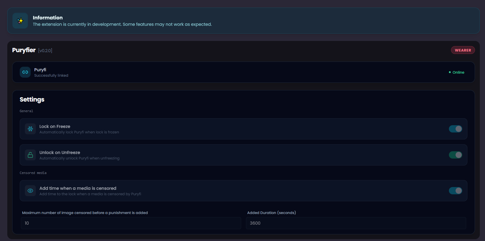

<p align="center">
  
  <br><b>🌙 Puryfier</b>
</p>

**Puryfier** is a Chaster extension that link [Pury.fi](https://pury.fi/) with [Chaster.app](https://chaster.app/) to provide more fun to your chastity locks and self lock.

## ✨ Key Features

- ❄️ Lock & Enable Puryfi when your lock is frozen.
- 🔓 Unlock & Disable Puryfi when your lock is unfrozen.
- 📸 Add time when media is censored by Puryfi.

## 🚀 Goals

Censorship is fun, even more when involving other things such as Chastity, Denial and more.. Puryfier is something made to help you to have fun with these.

## 📖 Requirements

- Puryfi 0.8.6.0 or higher (https://pury.fi)
- Docker (https://docs.docker.com/get-started/get-docker/)
- Chaster API Access & a Chaster Extension (https://chaster.app/developers/applications)
- Cloudflare (easiest way to host it https://cloudflare.com)

## 🌟 Run

**⚠ Fill the `.env` file before running using docker compose.**

```bash
git clone https://github.com/httxSereti/puryfier.git
cd puryfier
cp .env.example .env
docker compose up -d
```

## 🧑‍💻 Development

Requirements: Node.js 22.12+, pnpm 11+ and Python 3.12+ with [uv](https://docs.astral.sh/uv/).

The repository is a [Turborepo](https://turborepo.com) monorepo with two workspaces:
`front` (React + Vite) and `server` (FastAPI, managed with `uv`).

```bash
pnpm install   # installs Turborepo and the frontend dependencies
cp front/.env.example front/.env
cp server/.env.example server/.env
pnpm dev       # runs the frontend and backend together
```

| Command | Description |
| --- | --- |
| `pnpm dev` | Run the frontend dev server and the backend with reload |
| `pnpm build` | Build the frontend for production |
| `pnpm lint` | Lint the frontend |
| `pnpm test` | Run the backend test suite |

To target a single workspace, use `pnpm --filter server dev` (or `front`).

The backend needs a reachable MongoDB instance; set `DATABASE_URL` in `server/.env`
(or the repository `.env`). The quickest option is to start just the database from
Compose, which publishes it on `127.0.0.1:27017`:

```bash
docker compose up -d mongo
```

The backend tests use an in-memory MongoDB and do not need one.

## ❓ How to use

### Cloudflare

I recommend to use Cloudflare, its really easy and powerful, you'll need a Cloudflare token to be able to generate an SSL certificate (HTTPS)

Go to [API Tokens Page](https://dash.cloudflare.com/profile/api-tokens), generate a new API Tokens with these permissions

```md
Zone / DNS / Edit
Zone / Zone / Read
```

### Common

1. Copy .env.example as .env and fill it.
2. Run using Docker `docker compose up -d`
3. Create a Chaster extension with these URLs.

```md
Main page URL: <frontend-url>/extension/main
Configuration page URL: <frontend-url>/extension/configuration
Webhook URL: <backend-url>/api/webhooks/extensions/chaster
```

4. Create a Lock or Self-Lock with this extension.
5. Go to the extension in the lock settings page.
6. Link Chaster and Puryfi.
7. Enjoy!

## 🤝 How to Contribute / Contact Us

I've made a discord server to centralize information, suggestions, bugs and more.
You can join it [Join our discord here](https://discord.gg/vD8zyyMXne)

* 🌍 [Website](https://paa.ge/sereti)
* ✉️ [Email](mailto:httxsereti@gmail.com)
* 💜 [Discord](https://discord.com/users/939288874281222225)